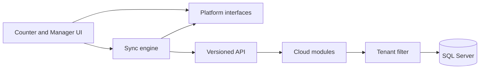
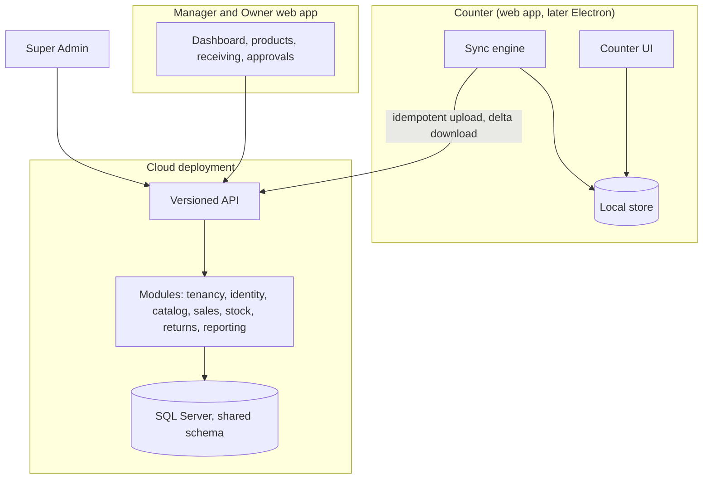

# Architecture Spine — POS System

## Design Paradigm

Cloud side: a modular monolith, one deployable, with modules by business area. Internal code organization (vertical slices, Clean/hexagonal or layered, CQRS/MediatR) is deferred.

Counter side: a client that works online and offline. A Sale is saved on the Counter first (milliseconds), then sent to the cloud as an append-only event right away when online, or queued and resent automatically when the connection returns.

## Invariants & Rules

Dependency direction:

### AD-1 — Counter is web-first and Electron-ready [ADOPTED]

- **Binds:** FR-3, FR-15, FR-16, NFR-1, NFR-3; all Counter code
- **Prevents:** UI and sync code coupled to browser storage, printing or crypto, which would turn a later Electron + SQLite move into a rewrite.
- **Rule:**
  - The Counter ships first as an installable web app (React + Vite + MUI, IndexedDB). It may later be wrapped in Electron with SQLite without changes above the interfaces below.
  - UI and business logic reach the platform only through these interfaces, never directly: `CounterStore` (sales, unsynced queue, catalog, cached credentials), `ReceiptPrinter`, `CashDrawer`, `Scanner`, `Crypto`.
  - The sync engine is plain TypeScript with no browser APIs. It takes a `CounterStore` and an HTTP client as inputs and is tested against a fake store.
  - `localStorage` and service-worker logic hold nothing that matters to a Sale. The Counter is a client-routed SPA with no server-side rendering.
  - Every sync and API payload carries a version number, so Counters can lag behind the server.
  - Counter and Manager/Owner screens are separate entry points in one codebase. Only the Counter entry is ever wrapped.
  - **Gate:** before this AD hardens, a spike must load 500,000 Products into IndexedDB, search by barcode and by name, and print a receipt on the real ESC/POS printer. Pass marks are the PRD NFR-10 targets: scan to cart under 200 ms, name search under 500 ms, Sale to printed receipt under 2 s. A miss moves the Counter to Electron + SQLite sooner.
  - Request persistent browser storage, and show the unsynced-Sale warning (FR-16), because browser storage can be cleared or evicted.

### AD-2 — Shared database, shared schema; tenant isolation applied centrally [ADOPTED]

- **Binds:** NFR-6; every cloud module
- **Prevents:** a module forgetting a filter and leaking data across Marts. SQL Server supports native Row-Level Security, but tenant isolation is still enforced through EF Core global query filters, not RLS, to keep one mechanism (the ORM layer) as the single source of truth rather than splitting enforcement between the database and the app.
- **Rule:**
  - Every tenant-owned table carries `MartId`, and `BranchId` where branch-scoped.
  - Isolation is applied by EF Core global query filters, never per query. No hand-written unfiltered queries.
  - An automated two-Mart isolation test must pass in CI.
  - Moving a large Mart to its own database later stays possible. Database-per-Mart and schema-per-Mart were rejected for now (N migrations, harder onboarding, harder cross-Mart Super Admin reporting).

### AD-3 — Tenant hierarchy and data scope [ADOPTED]

- **Binds:** FR-25, FR-26, NFR-6
- **Prevents:** stock, price or product data bleeding across the wrong level.
- **Rule:**
  - Hierarchy is Mart > Branch > Counter.
  - Stock is per Branch. The Product list is Mart-wide, with an optional per-Branch price.
  - There are no stock transfers between Branches in v1.
  - The Super Admin is seeded in the database, creates and suspends Marts and their Owners, and has no access to a Mart's sales or stock.
  - There is no billing in v1; Marts are switched on and off manually.
  - Currency and settings are per Mart.

### AD-4 — Identity belongs to exactly one Mart [ADOPTED]

- **Binds:** FR-1, FR-3, NFR-6
- **Prevents:** cross-Mart identity, shared logins and Mart-context confusion.
- **Rule:**
  - Every account belongs to exactly one Mart. The same person in two Marts has two accounts. There is no global Person, Membership or SSO in v1.
  - Login is Mart (implicit at a registered Counter, otherwise a Mart code) + Staff ID (unique within the Mart) + the account's own PIN or password.
  - The Owner creates staff; the system generates the Staff ID and a one-time activation code. Staff set their own PIN at first login, so nobody else knows it.
  - Resets issue a new activation code and kill the old PIN. They are audited. The Owner may reset anyone; others only lower roles.

### AD-5 — Server enforces role, branch and device on every request [ADOPTED]

- **Binds:** FR-1, FR-2, NFR-3
- **Prevents:** client-side-only permission checks and editing from unregistered machines.
- **Rule:**
  - The server checks Permission, Branch assignment and Registered Device on every request.
  - Roles are custom per Mart, built from a fixed Permission list. Cashier and Manager are starter Roles. The Owner is not an editable Role: it holds every Permission in every Branch.
  - Roles are assigned per Branch. A Permission acts on Mart-wide data (Products, Mart price, suppliers, Roles, Audit Log) only if the user holds it in every active Branch (decided 2026-10-13).
  - Every write request, and any session with a selling Permission, requires a Registered Device of that Branch. The Owner's home PC and phone are read-only dashboards and can never be registered for editing.
  - Device registration is an admin action tied to on-site machines. The Owner can revoke a lost device.

### AD-6 — Stock is the sum of additive Stock Events; Counters never receive quantities [ADOPTED]

- **Binds:** FR-15, FR-16, NFR-8
- **Prevents:** write conflicts between Counters and a catalog download too heavy for offline use.
- **Rule:**
  - Stock changes only by appending Stock Events (Sales, Returns, Deliveries, Spot Count corrections). Nothing overwrites a quantity.
  - Two Counters selling the same Product offline never conflict, and stock reflects both.
  - Stock quantities are not synced to Counters. Negative stock is allowed and appears in the Exceptions Report, not on the Cashier's screen.

### AD-7 — Sync contract [ADOPTED]

- **Binds:** FR-15, FR-16, FR-23
- **Prevents:** lost or duplicated Sales, stale or oversized Counter catalogs, and one bad event blocking all later Sales.
- **Rule:**
  - **Upload is idempotent.** Each Sale, Return request and approval carries a client-generated ID, and the server stores each ID once and ignores repeats. Upload runs oldest first, in batches.
  - **Receipt numbers** follow FR-23 (Counter code plus running count).
  - **Download is a delta by version cursor.** The cloud wins for Products and prices. Deactivations and deletions travel as changes too, so a Counter stops selling a removed Product.
  - **Real time while online.** An online Counter sends each Sale within seconds and receives Product edits other than price within seconds (the mechanism, push or short polling, is left to implementation). Offline, it queues and resyncs by itself when the connection returns.
  - **Prices are staged.** A saved price change reaches Counters but takes effect only at the next Shift boundary (Shift close or open), so no Sale is made at a new price mid-Shift. Each Sale line records the price it was sold at; no price version is stored.
  - **Retention:** a Counter keeps each event until the server acknowledges it, then keeps the local copy for 48 hours before clearing it.
  - **Rejected events are parked.** If the server rejects an event as invalid, the Counter parks it, flags it on the Counter and in the Owner's view, and keeps syncing later events. A parked event is never deleted.
  - **Clocks:** each event records the Counter's time and the server's receive time. Ordering and reports use the server time.
  - **Parked events are view-only.** There is no accept or dismiss action; their effect on stock is put in through normal correcting Stock Events.
  - **Revoked device or deactivated Branch:** the server still takes uploads from it. Events with Counter time before the revoke or deactivation are accepted and flagged; later ones are parked. The device never gets a session or sells again.
  - **Restore epoch.** The server carries a restore epoch. After a database restore it is raised, and every Counter that sees a new epoch re-sends every event it still holds (including acknowledged ones within 48 hours). Idempotent IDs drop repeats. This relies on hourly backups (PRD NFR-2), well inside the 48-hour retention.
  - **First catalog download** (at least 500,000 Products, about 50-100 MB) is paged, compressed and resumable, with a barcode-keyed local index. A new or replaced Counter cannot sell until the full catalog is downloaded. It always comes from the cloud; Counters never copy from each other.

### AD-8 — Returns need approval [ADOPTED]

- **Binds:** FR-8, FR-24
- **Prevents:** returns changing totals or stock before an authorized person accepts them.
- **Rule:**
  - A Return is a request. Until accepted it changes no totals and no stock.
  - Approving is a Permission (Owner and Manager by default). Nobody approves their own Return.
  - Approval happens at the Counter with the approver's credentials, which works offline with a cached login, or on the approver's own Registered Device.
  - The approver chooses restock or damaged. Only restock adds to sellable stock. The refund is handed over after approval.
  - An offline approval takes effect on Sync. If the approver's account was disabled or lost the Permission before the approval reached the server, the Return is still accepted and flagged in the Exceptions Report.
  - The refund amount is the price each returned Unit is selling at on that Counter at request time (decided 2026-10-13).
  - If a Return is decided both at the Counter and on another device, the Counter's decision wins and the other is flagged in the Exceptions Report (decided 2026-10-13).
  - Cash refunds count in the Shift open on the Counter at acceptance, and closed Shifts are never recomputed.

### AD-9 — Offline credentials and device trust [ADOPTED]

- **Binds:** FR-3, NFR-3
- **Prevents:** offline login that outlives revocation in an unbounded way, and credentials stored in recoverable form.
- **Rule:**
  - Credentials needed for offline login are stored hashed only, with a slow password hash. PINs are at least 6 digits.
  - After 5 wrong PINs, the Staff ID is locked on that Counter for 5 minutes, doubling on each repeat. The lock is kept in the Counter store so it works offline, and failures sync up for the Exceptions Report.
  - Only accounts active at the last Sync, and assigned to the Counter's Branch, can log in offline.
  - Cached credentials, unsynced Sales and the device token are encrypted at rest. The local Product catalog is not encrypted (decided 2026-10-07); it is not secret and is too large to encrypt cheaply.
  - A Counter must reach the server at least every 72 hours. The Counter measures this from the last successful Sync and warns when less than 24 hours remain. After 72 hours it lets a Sale in progress finish, then accepts no new logins or Sales until it syncs. The 72 hours are elapsed time, not wall-clock time, so changing the Counter's clock does not extend them. Unsynced data stays stored and is never deleted.
  - An online Counter of a suspended Mart uploads its unsynced data (accepted by the server) and then locks. Anything it could not upload stays stored. After reactivation it must complete a Sync before it can sell (decided 2026-10-13).
  - A disabled account, revoked device or suspended Mart takes effect on the Counter's next contact with the server, and at the latest when the 72-hour limit is reached.

### AD-10 — Current stock is a maintained balance beside the event log [ADOPTED]

- **Binds:** FR-6, FR-11, FR-12, FR-13, FR-14, FR-18, FR-19, FR-24
- **Prevents:** dashboards and stock screens summing millions of Stock Events on every read, and a balance that drifts from the events behind it.
- **Rule:**
  - The cloud keeps one balance row per Product and Branch (`MartId`, `BranchId`, `ProductId`, quantity in Units), alongside the Stock Event log.
  - The Stock Event log is the source of truth. The balance is derived from it and is never edited directly.
  - A balance changes only in the same database transaction that inserts a new Stock Event. An event ignored as a repeat (AD-7) changes no balance.
  - Every stock read (dashboard, low and negative stock lists, Spot Count, stock search) uses the balance.
  - A scheduled check recomputes balances from the events and reports any difference in the Exceptions Report. It does not fix it silently.
  - The balance lives in the cloud only. It is never sent to Counters (AD-6).

### AD-11 — Barcodes point to exactly one Product [ADOPTED]

- **Binds:** FR-4, FR-5, FR-9, FR-10, FR-28, NFR-8
- **Prevents:** a scan that is ambiguous or needs a choice at the Counter, and Barcode data that cannot express generic Products or packs.
- **Rule:**
  - Barcodes live in their own table (`MartId`, `Barcode`, `ProductId`, Units per scan, default 1), unique on (`MartId`, `Barcode`). A Product has many Barcodes; a Barcode has one Product.
  - A generic Product is an ordinary Product with several brands' Barcodes linked to it. There is no separate group or variant entity, and nothing at the Counter picks a variant.
  - A pack Barcode is a Barcode whose Units per scan is above 1. Stock Events are always in Units.
  - In-store codes are EAN-13 from the 20–29 prefix range, generated by the server and unique within the Mart.
  - The Counter's local index is keyed by Barcode and returns `ProductId` plus Units per scan. Barcode moves and removals travel in the delta like other non-price edits (AD-7).

### AD-12 — Time is stored in UTC and reported in the Branch's time zone [ADOPTED]

- **Binds:** FR-17, FR-18, NFR-11
- **Prevents:** "today" and daily totals shifting at midnight UTC instead of local midnight, and mixed time zones in one report.
- **Rule:**
  - Every stored timestamp is UTC.
  - Each Branch has an IANA time zone (default `Asia/Karachi`); the Mart has a default zone for Mart-wide reports.
  - Day boundaries are computed in the zone of the Branch (or the Mart for Mart-wide views), never on the server's local time.

## Consistency Conventions

| Concern | Convention |
| --- | --- |
| Naming | Terms follow the PRD glossary: Mart, Branch, Counter, Sale, Return, Delivery, Sales Receipt, Registered Device, Sync, Stock Event |
| Data & formats | PKR whole rupees by default, configurable per Mart; English-only UI; tax included in prices, no tax handling; Sale and Return IDs generated on the Counter |
| State & cross-cutting | All tenant filtering through EF global query filters; every API and sync payload versioned; every privileged action audited (resets, approvals, device changes, Spot Count corrections) |

## Stack

| Name | Version |
| --- | --- |
| .NET | 10 (LTS, supported to Nov 2028) |
| EF Core | 10 |
| Microsoft.EntityFrameworkCore.SqlServer | 10 |
| SQL Server | 2025 Developer Edition (local dev) |
| React | 19.3.0 (latest stable; inside the @mui/material 9.1.x peer range, React 17 to 19, so not held back) |
| Vite | 8.3.4 (latest stable; supported by @vitejs/plugin-react 6.1.2 and Vitest 5.0.4 peers) |
| MUI (Material UI) | 9.1.x |

## Structural Seed

## Capability → Architecture Map

| Capability / Area | Lives in | Governed by |
| --- | --- | --- |
| FR-1 Roles and accounts | Identity module | AD-4, AD-5 |
| FR-2 Registered Devices | Identity module | AD-5 |
| FR-3 Offline login | Counter, Identity module | AD-1, AD-9 |
| FR-8, FR-24 Returns and approval | Counter, Returns module | AD-8 |
| FR-15 Offline selling | Counter | AD-1, AD-6, AD-7 |
| FR-16 Sync | Sync engine, API | AD-6, AD-7 |
| FR-13, FR-14, FR-18 Stock levels and counts | Stock module | AD-6, AD-10 |
| FR-4, FR-5, FR-9, FR-10, FR-28 Products and Barcodes | Catalog module, Counter store | AD-7, AD-11 |
| FR-22 Device recovery, Owner recovery | Identity, Tenancy modules | AD-5, AD-7 |
| NFR-2 Backup and restore | Cloud database, sync engine | AD-7 (restore epoch) |
| NFR-11 Time zones | Reporting module | AD-12 |
| FR-25 Super Admin | Tenancy module | AD-3 |
| FR-26 Branches | Tenancy module | AD-3 |
| NFR-6 Tenant isolation | All cloud modules | AD-2 |
| NFR-8 Scale | Counter store, catalog sync | AD-7 (PRD sized to match) |

### AD-14 — Database engine: SQL Server, not MySQL [ADOPTED]

- **Binds:** all cloud modules, hosting/backup choice (NFR-2), AD-2 (tenant isolation mechanism)
- **Prevents:** running a MySQL instance (via Docker/WSL2, not yet set up on the owner's machine) just to unblock local development, when a usable SQL Server instance (managed through SSMS) is already available.
- **Rule:**
  - Supersedes the earlier MySQL 8.4 LTS stack decision (2026-10-06). Data access is .NET 10 + EF Core 10 via `Microsoft.EntityFrameworkCore.SqlServer`.
  - Local dev and CI both target SQL Server; the hosting platform decision (Story 1.8) must support SQL Server backups/PITR instead of MySQL ones.
  - Tenant isolation stays enforced via EF Core global query filters (AD-2), not native SQL Server Row-Level Security, for one reason: avoid splitting the enforcement mechanism across the ORM and the database.
- Decided 2026-11-10, owner-driven (SSMS/SQL Server already set up locally; Docker Desktop + WSL2 for MySQL were not yet ready).

### AD-13 — Backend code organization: vertical slices, no MediatR [ADOPTED]

- **Binds:** all backend modules (tenancy, identity, catalog, sales, stock, returns, reporting)
- **Prevents:** a grab-bag `Services/` layer growing unrelated methods as stories pile up, and MediatR/CQRS ceremony that outruns the team's current .NET experience.
- **Rule:**
  - Each feature (e.g. "Create Mart") owns a folder with its endpoint, request/response types, validation and DB query together. No shared generic Service layer, no MediatR pipeline.
  - The modular monolith boundary stays at the module level (tenancy, identity, catalog, sales, stock, returns, reporting); vertical slices live inside each module.
  - Revisit only if the team grows enough that cross-cutting pipeline behaviors (logging, validation, auth) become repetitive across many slices.
- Decided 2026-11-09 for Story 1.1 (backend half).

## Deferred

- **Hosting platform:** not chosen. It must support hourly (point-in-time) SQL Server backups (PRD NFR-2, per AD-14). Chosen and recorded as an AD in Story 1.8.
- **Not yet governed by an AD:** Audit Log immutability (FR-20), device token lifecycle (FR-22), background jobs (500,000-row Product import, opening stock import, scheduled stock balance check), and the push vs short polling mechanism for real-time sync (chosen in Story 4.4; it must carry catalog changes, Return decisions and staff and device changes to Counters).
- **Provider and database versions:** local dev uses SQL Server 2025 Developer Edition (AD-14); production SQL Server version not yet pinned — revisit once a hosting platform (Story 1.8) is chosen (most managed hosts cap out below 2025).
